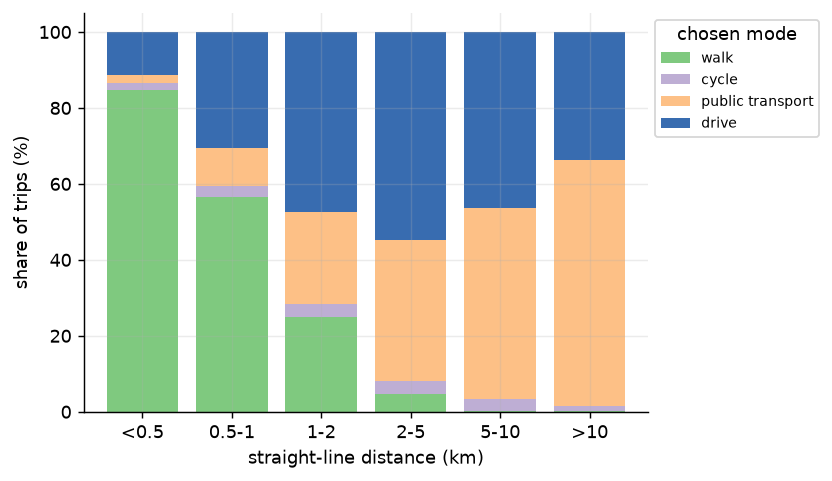
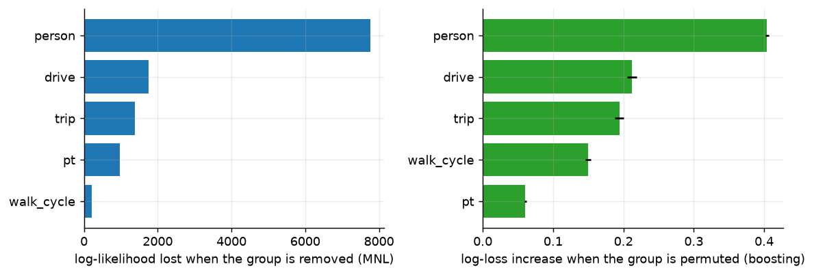
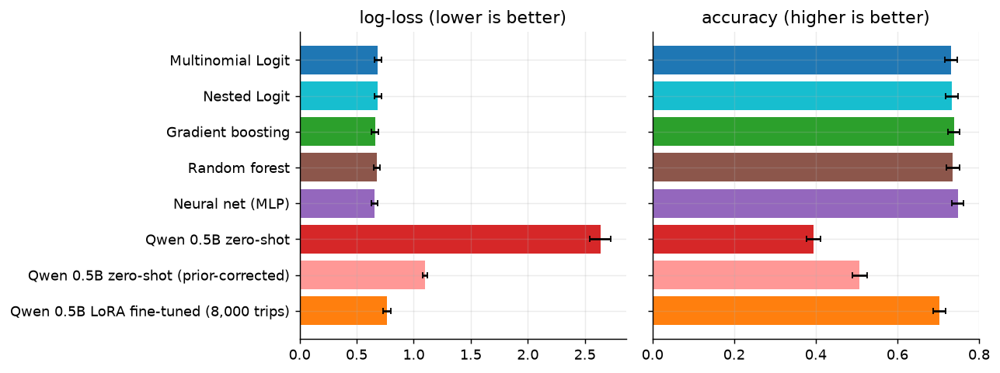
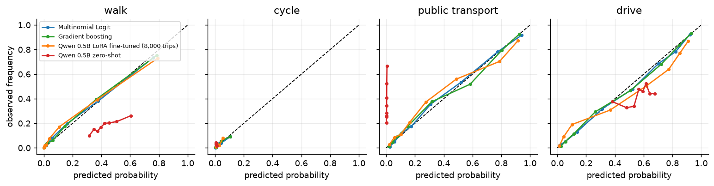
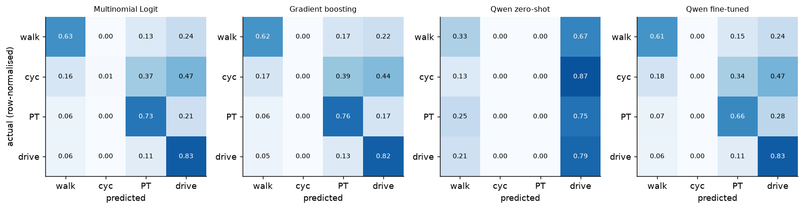
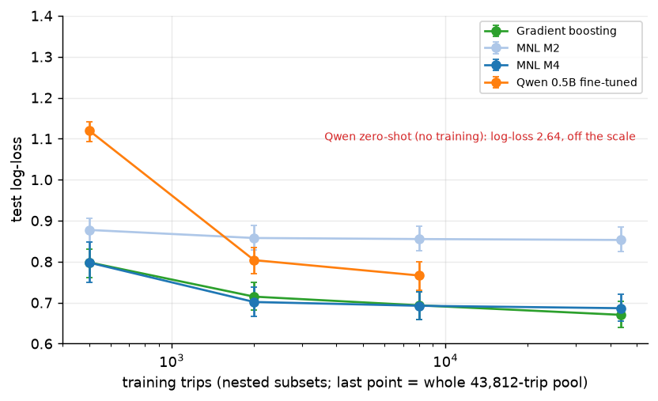
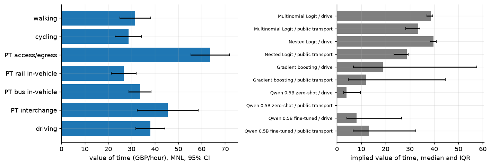
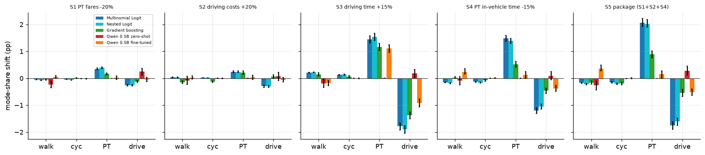

# Modelling Commuter Mode Choice in London: Discrete Choice Models, Machine Learning and a Fine-Tuned Small Language Model

Group project report. Authors: [group members to be added].

---

## Abstract

This project models the choice among walking, cycling, public transport and car using 81,086 real trips from the London Passenger Mode Choice dataset, as an open substitute for the Indian multi-mode dataset described in the course brief. Models were trained on the first two survey years and tested on the third, with validation grouped by household to prevent leakage. A Multinomial Logit with 67 parameters achieves 73.8% accuracy (log-loss 0.684) and Nested Logit shows that the car is the main separate alternative without improving prediction. Gradient boosting and a neural network are slightly better (accuracy 74.6%, log-loss 0.657), matching published results, but respond unreliably to counterfactual changes: for example, gradient boosting predicts no fall in car use when driving costs rise. A 0.5-billion-parameter language model is unable to predict mode choice zero-shot (39% accuracy) and reaches 70% accuracy (log-loss 0.77) after LoRA fine-tuning on 8,000 trips, still behind every classical model. Car availability and personal characteristics dominate mode choice, and time attributes matter more than costs; the effect of fares cannot be identified in this data. Slowing driving by 15% moves about 1.8 percentage points of trips from car to mainly public transport.

---

## 1. Introduction

Individual travel mode choices vary with socio-demographic characteristics, trip attributes and the service characteristics of the available modes. Understanding these variations supports urban transport planning and policy. This project models the choice among walking, cycling, public transport and car for urban trips, using the London Passenger Mode Choice (LPMC) dataset.

The course brief describes a dataset from an Indian city with walking, two-wheelers, auto-rickshaws, cars, buses and local trains, together with income, education, occupation, dwelling type and parking variables. No public dataset with that combination exists. LPMC is the closest open alternative: it contains real, individual-level choices together with mode-specific travel times and costs. The methods used here carry over unchanged; the differences are the city, the set of modes (four instead of six) and the available personal variables (no income, education or occupation).

The project has five aims.

1. Identify the factors associated with mode choice and their relative importance, using Multinomial Logit (MNL) and Nested Logit (NL).
2. Estimate choice probabilities and compare predictive performance across model families, including gradient boosting, a random forest, a neural network and a small language model used zero-shot and after fine-tuning.
3. Quantify what travellers value: the value of travel time and demand elasticities.
4. Simulate how mode shares respond to policy changes in fares, driving costs and travel times.
5. Test whether a small language model can learn travel behaviour from survey data, and how much data it needs.

---

## 2. Data

### 2.1 Source and construction

LPMC (Hillel, Elshafie and Jin, 2018) is built from the London Travel Demand Survey (LTDS), a rolling household travel survey run by Transport for London (TfL). Trip diaries from April 2012 to March 2015 were used. Trips outside London and trips that did not use TfL services were removed by the dataset's authors, leaving 81,086 trips made by 31,954 people in 17,616 households.

A trip diary records only the mode that was used. To obtain the alternatives, the authors passed each trip through an online journey planner, which produced a route and travel time for each of the four modes, and then applied a cost model to compute individual-specific public transport fares, fuel costs and congestion charges. The attributes of every mode, including the chosen one, are therefore modelled rather than observed. Expansion factors exist in the original survey but are not provided, so all results describe the sample and not the population of London.

### 2.2 Variables

Times are in hours and costs in pounds in the source file; we convert times to minutes. The chosen mode is coded 1 walk, 2 cycle, 3 public transport, 4 car. Personal variables are age, gender, driving licence, household car ownership (no car, fewer than one car per adult, at least one per adult), fare type (full fare, age 16+, child, disabled, free pass) and bus fare scale (free, half, full). Trip variables are purpose (home-based work, home-based education, home-based other, employer's business, non-home-based other), straight-line distance, start time and day of week. Mode attributes are travel time for walking and cycling; access, rail, bus and interchange time, number of interchanges and fare for public transport; and driving time, fuel cost, congestion charge and traffic variability for the car. Total public transport time is the sum of its four components, and total driving cost is fuel plus congestion charge, as the documentation prescribes.

### 2.3 Data quality

We verified the file against the documentation. There are no missing values, no duplicate rows or trip identifiers, and the counts of trips, people and households match. Driving time and public transport time are never zero, so all four alternatives exist for every trip. No row was removed or altered. Several features of the data matter for interpretation:

- **The car mode includes passengers.** 23% of car trips (8,322 of 35,808) are made by people without a driving licence, and 5,053 by people aged under 17. We therefore treat all four modes as available for every trip, as in the source paper, and call the mode "car (driver or passenger)".
- **Cycling is rare** (3.0% of trips).
- **A third of public transport fares are zero** (32.7%), mostly because of free passes. Fare is also strongly related to distance (correlation 0.74 among fare-paying trips).
- **Households are disjoint across survey years.** No household or person appears in more than one year.

Overall mode shares are 17.6% walk, 3.0% cycle, 35.3% public transport and 44.2% car. Shares are stable across survey years (car 44.0%, 45.6%, 42.8%), so the test year is a fair but not trivial forecasting setting. Figure 1 shows the dependence of mode on distance: walking dominates below 1 km, public transport and car dominate beyond 2 km, and cycling remains small throughout.



---

## 3. Methodology

### 3.1 Training, validation and test design

The test set is survey year 3 (April 2014 to March 2015), 26,320 trips. The training pool is survey years 1 and 2 (54,766 trips). Training on the past and testing on a later year mirrors the intended use of choice models, which are estimated on earlier surveys to forecast later conditions. Because no household appears in both periods, the test set cannot benefit from other trips of the same people, which would otherwise inflate scores. All tuning used five folds of the training years grouped by household. The test set was not used to choose any model, specification or setting.

For the language model, a fixed 1,000-trip validation set was drawn from one fold, and the fine-tuning trips were drawn only from the other four folds, so validation and training households are disjoint. Because running a language model over 26,320 test trips three times is too slow on a laptop with 8 GB of memory, every model is additionally scored on a fixed random sample of 4,000 test trips drawn before any modelling. The classical models are scored on both the full test set and the sample, which shows that the sample is representative. Confidence intervals are 95% intervals from a household-level bootstrap with 1,000 resamples; model differences are paired on the same resamples.

### 3.2 Multinomial Logit

The utility of mode *j* for trip *n* is a linear function of the mode's attributes and the traveller's characteristics, plus an alternative-specific constant; walking is the reference alternative. The choice probability is the softmax of utilities. Models were estimated by maximum likelihood with Biogeme 3.3.5 and robust standard errors. We built the specification in five steps (M0 constants only; M1 common time and cost coefficients; M2 mode-specific time coefficients, public transport time split into access, rail, bus and interchange time plus a penalty per interchange, and traffic variability; M3 adding person variables; M4 adding trip variables), tested each step with likelihood-ratio tests, and chose the specification with the lowest BIC. Time and cost coefficients are required, and checked, to be negative.

### 3.3 Nested Logit

Nested Logit relaxes the independence from irrelevant alternatives property of MNL by correlating the random terms of alternatives in the same nest, through a nest parameter μ ≥ 1 (μ = 1 recovers MNL). Two structures were estimated on the selected MNL specification: {walk, cycle} versus {public transport, car}, and {walk, cycle, public transport} versus {car}. Nest parameters were tested against 1.

### 3.4 Machine learning models

Gradient boosting (scikit-learn's histogram implementation) was tuned over 10 random settings with five household-grouped folds; the number of trees was chosen by validation log-loss. A random forest and a small neural network (a multilayer perceptron with standardised inputs and one-hot encoding of purpose and fare type, averaged over five random starts) were tuned lightly on one training fold. All use the same trip information as the logit models, and the same bootstrap and metrics.

### 3.5 Language model

We used Qwen2.5-0.5B-Instruct, run locally with Apple's MLX framework. Each trip is converted into a short text describing the traveller, the trip and the four options with their times (to one decimal minute) and costs, and the model is asked to answer with one word. Instead of generating text, we read the model's scores for the first token of each answer word in a single forward pass and apply a softmax, which gives four probabilities per trip with no parsing step. The zero-shot model is used as is. The fine-tuned model is trained with LoRA (rank 8, on the query, key, value and output projections of all 24 layers, 1.08 million trainable parameters), with the loss applied only to the answer word, for one epoch over 8,000 training trips. The learning rate was chosen among five values on a 2,000-trip run using validation log-loss only. To measure how much data fine-tuning needs, we repeated it with nested subsets of 500 and 2,000 trips, and fitted MNL and gradient boosting on the same subsets.

### 3.6 Evaluation metrics

Models are compared mainly by multiclass log-loss, a proper scoring rule suitable for every model because all produce probabilities. We also report accuracy, macro-F1 and per-mode recall (important because cycling is rare), the Brier score, expected calibration error (ECE), and the mode-share error, which is the mean absolute difference between the average predicted share and the observed share over the four modes. To compare with published work we also give GMPCA, the geometric mean probability assigned to the chosen mode, which equals exp(−log-loss).

### 3.7 Behavioural analysis

The value of time is the ratio of a time coefficient to the cost coefficient, expressed in pounds per hour, with delta-method confidence intervals; it is also estimated separately for fare-paying travellers, commuters, other purposes and by household car ownership. For models without coefficients we define an implied value of time from probability responses: the change in a mode's probability per extra minute divided by the change per extra pound, taken from perturbations of 15% and 20%. Arc elasticities and mode-share shifts are computed for five policy scenarios (PT fares −20%; driving costs +20%; driving time +15%; PT in-vehicle time −15%; and the three improvements to public transport and driving costs combined). A monotonicity check records how often a model moves a mode's probability the wrong way when its own cost or time worsens or improves.

---

## 4. Discrete choice results

### 4.1 Multinomial Logit specification

Table 1 shows the specification ladder. Each step improves the fit by far more than the likelihood-ratio test requires (all p < 0.001), and BIC is lowest for M4, which was therefore selected. Adding mode-specific times raises the pseudo R-squared from 0.19 to 0.27, person variables to 0.39 and trip variables to 0.41.

| Model | Parameters | Log-likelihood | Pseudo R² | BIC | Likelihood-ratio test vs previous |
|---|---|---|---|---|---|
| M0 constants | 3 | −62,036 | 0.000 | 124,104 | |
| M1 common time and cost | 5 | −50,414 | 0.187 | 100,882 | 23,244 (2 df) |
| M2 mode-specific times | 13 | −45,627 | 0.265 | 91,396 | 9,573 (8 df) |
| M3 + person variables | 46 | −37,725 | 0.392 | 75,953 | 15,803 (33 df) |
| **M4 + trip variables** | 67 | −36,351 | 0.414 | **73,432** | 2,750 (21 df) |

*Table 1: MNL specification ladder, estimated on the training years (54,766 trips). Walking is the reference mode.*

All time, interchange and cost coefficients are negative and highly significant. Public transport access time is the most heavily penalised (−0.096 per minute), followed by interchange time (−0.069), car time (−0.058), bus time (−0.051) and rail time (−0.040); each interchange adds a further penalty of 0.18. Traffic variability strongly reduces the attractiveness of driving (−2.6). Among personal variables, car ownership is the dominant factor: relative to walking, having fewer than one car per adult raises the utility of driving by 2.0 and having one or more per adult by 2.5, while it lowers the utility of public transport by 0.5 and 0.7. Holding a licence raises driving utility by 0.9. Women are much less likely to cycle (−0.81) and somewhat more likely to use public transport (+0.26). Free-pass status has little additional effect on public transport once the other variables are included, while a free or half-price bus scale raises public transport utility. Longer trips shift choice away from walking: the coefficient on log distance is 2.6 for public transport, 1.9 for car and 1.1 for cycling. Trip purpose matters for the car: relative to commuting, the car is more attractive against walking for home-based other trips (+0.66), employer's business trips (+1.06) and non-home-based trips (+0.75), and about equal for education trips (+0.17).

### 4.2 Importance of variable groups

Removing a group of variables from M4 and testing the loss of fit shows that person characteristics matter most (33 parameters; log-likelihood falls by 7,760), followed by car service attributes (time and traffic; 1,747), trip variables (1,375), public transport service (966) and walk and cycle times (215). In the boosting model, shuffling a group of variables raises validation log-loss most for person variables (0.404), then driving attributes (0.212), trip variables (0.194), walking and cycling times (0.150) and public transport service (0.061). The two methods agree that personal characteristics, above all car availability, drive mode choice; they differ on public transport service, partly because the removed logit group has only five parameters and partly because boosting can recover public transport information from distance and the other variables (Figure 8).



### 4.3 Nested Logit

The structure with car on its own against {walk, cycle, public transport} is supported: the nest parameter is 1.31 (t = 6.8 against 1), the likelihood-ratio statistic against MNL is 66 with one degree of freedom, and BIC falls from 73,432 to 73,377. The structure {walk, cycle} versus {public transport, car} is not supported for the active nest, whose parameter sits at the lower bound of 1 (the motorised nest is 1.22, t = 4.6). The data therefore suggest that the main substitution pattern is between the car and all other modes, not between active and motorised modes. Although Nested Logit fits significantly better, it does not predict better out of sample (section 5).

### 4.4 Sensitivity of the cost coefficient

With a single cost coefficient shared by public transport fares and driving costs, we obtain −0.091 per pound. When we give the two their own coefficients, the driving cost coefficient is −0.104, but the public transport fare coefficient becomes +0.102, which has the wrong sign. The fit improves significantly (likelihood-ratio statistic 115), but the sign makes it behaviourally implausible. Fares are largely determined by distance and zones, a third are zero because of free passes, and the fare therefore carries little information about preferences once distance, time and fare status are controlled for. In effect the shared cost coefficient is identified from driving costs. We keep the shared coefficient, because economic theory implies a single marginal utility of money, but all conclusions about fare changes depend on this assumption.

---

## 5. Predictive comparison

### 5.1 Overall performance

Table 2 compares all models on the shared 4,000-trip test sample, drawn from the later survey year. The reference predictor assigns every trip the training market shares.

| Model | Log-loss [95% CI] | Accuracy [95% CI] | Macro-F1 | ECE | Mode-share error | GMPCA |
|---|---|---|---|---|---|---|
| Training market shares (reference) | 1.146 [1.127, 1.164] | 42.3% [40.5, 44.3] | 0.149 | 0.024 | 0.0122 | 0.318 |
| Multinomial Logit | 0.686 [0.656, 0.716] | 73.2% [71.6, 74.6] | 0.547 | 0.021 | 0.0059 | 0.504 |
| Nested Logit | 0.686 [0.656, 0.715] | 73.3% [71.9, 74.8] | 0.548 | 0.019 | 0.0061 | 0.504 |
| Gradient boosting | 0.661 [0.630, 0.689] | 73.9% [72.4, 75.3] | 0.547 | 0.028 | 0.0049 | 0.516 |
| Random forest | 0.679 [0.651, 0.706] | 73.6% [72.0, 75.1] | 0.546 | 0.024 | 0.0038 | 0.507 |
| Neural network (MLP) | **0.657** [0.626, 0.686] | **74.9%** [73.3, 76.3] | **0.556** | 0.024 | 0.0055 | 0.518 |
| Qwen 0.5B zero-shot | 2.637 [2.544, 2.728] | 39.4% [37.8, 41.2] | 0.211 | 0.198 | 0.1929 | 0.072 |
| Qwen 0.5B zero-shot, prior-corrected | 1.102 [1.081, 1.122] | 50.7% [49.0, 52.6] | 0.274 | 0.033 | 0.0111 | 0.332 |
| Qwen 0.5B LoRA fine-tuned (8,000 trips) | 0.766 [0.732, 0.801] | 70.3% [68.7, 71.8] | 0.523 | 0.069 | 0.0182 | 0.465 |

*Table 2: test performance on the shared 4,000-trip sample (survey year 3). Intervals are household-level bootstrap intervals. ECE is the expected calibration error. GMPCA is exp(−log-loss), reported to allow comparison with published work.*



On the full test set of 26,320 trips the classical models give the following log-loss and accuracy: MNL 0.684 and 73.8%, Nested Logit 0.683 and 73.8%, gradient boosting 0.657 and 74.6%, random forest 0.676 and 74.2%, neural network 0.657 and 74.6%. The sample therefore reproduces the full-set ranking and levels closely.

Four findings stand out.

**First, all classical and machine-learning models predict similarly well.** Gradient boosting and the neural network are the best, with a log-loss about 0.025 to 0.029 below MNL (paired 95% intervals [−0.035, −0.015] and [−0.041, −0.018]); they are statistically indistinguishable from each other (difference 0.004, interval [−0.004, 0.012]). Random forest is not significantly better than MNL (−0.007, [−0.018, 0.004]) and is worse than gradient boosting. The advantage of flexible models is real but modest: about one percentage point of accuracy. The MNL, with 67 parameters, already captures most of the predictable variation.

**Second, Nested Logit does not improve prediction**, although it fits the training data significantly better (paired difference −0.0005, interval [−0.0018, 0.0009]).

**Third, the zero-shot language model fails.** Its log-loss of 2.64 is worse than the market-share reference of 1.15, and its accuracy of 39% is below the 42% of always predicting car. It predicts only walking or car (recall for public transport is zero). Its scores depend heavily on how the options are ordered in the prompt: on the validation trips, reversing the order of the options changed the predicted mode for 74% of trips. Adding a fixed correction per mode, fitted on validation trips, removes most of the error (log-loss 1.10), which shows that much of the failure is a wrong prior over modes, but the corrected model remains far from useful.

**Fourth, fine-tuning transforms the language model but does not close the gap.** After training on 8,000 trips the log-loss falls from 2.64 to 0.77 (paired difference −1.87, interval [−1.96, −1.78]) and accuracy rises from 39% to 70%. It remains worse than MNL by 0.080 (interval [0.065, 0.096]) and than gradient boosting by 0.105 (interval [0.091, 0.121]), and about 3 to 4 percentage points less accurate. Its probabilities are also less well calibrated (ECE 0.069 against 0.02 to 0.03 for the other models) and its aggregate mode-share error (0.018) is three times that of the logit model (Figure 4). The fine-tuned model also still depends on the order in which the options are listed: it was always trained with the options in the order walk, cycle, public transport, car, and when the order is reversed on the validation trips, 33% of its predictions change, log-loss rises from 0.72 to 1.00 and accuracy falls from 73% to 56% (for the zero-shot model, 74% of predictions change). Training with randomised option order would probably reduce this dependence; we did not test that.



### 5.2 Performance by mode and by segment

All models are good at the three large modes and fail on cycling, which is 3% of trips. Recall for cycling is below 1% for every model. Table 3 gives recall by mode.

| Model | Walk | Cycle | Public transport | Car |
|---|---|---|---|---|
| Multinomial Logit | 0.629 | 0.008 | 0.728 | 0.829 |
| Gradient boosting | 0.615 | 0.000 | 0.765 | 0.820 |
| Neural network | 0.632 | 0.000 | 0.784 | 0.820 |
| Qwen zero-shot | 0.326 | 0.000 | 0.000 | 0.792 |
| Qwen fine-tuned | 0.614 | 0.000 | 0.657 | 0.830 |

*Table 3: recall by mode on the 4,000-trip sample.*

Models rank similarly across segments, but difficulty varies sharply (Table 4 reports gradient boosting). Trips between 1 and 2.5 km are the hardest (accuracy 64%, log-loss 0.88), because walking, public transport and car are all plausible there; trips over 10 km are the easiest (83%, log-loss 0.40). Households with fewer than one car per adult are harder than those with no car or ample cars (71% against 75% and 76.5%), again because there the choice is genuinely open. The fine-tuned language model loses most on long trips (over 10 km: log-loss 0.58 against 0.40 for boosting) and on the intermediate car ownership group. Figure 5 shows the confusion matrices.



### 5.3 How much data does each model need?

Figure 3 shows test log-loss against the number of training trips, using nested subsets of the household-disjoint training pool (the largest point is the whole pool of 43,812 trips, which excludes the fold reserved for language-model validation).



| Training trips | MNL (M4) | Gradient boosting | Qwen fine-tuned |
|---|---|---|---|
| 500 | 0.798 | 0.798 | 1.120 |
| 2,000 | 0.702 | 0.715 | 0.804 |
| 8,000 | 0.692 | 0.693 | 0.766 |
| 43,812 | 0.686 | 0.670 | not trained |

*Table 5: test log-loss on the 4,000-trip sample by number of training trips. The zero-shot language model (no training) has a log-loss of 2.64.*

The fully specified logit model is remarkably data-efficient: with 500 trips it already achieves a log-loss of 0.80, and with 2,000 trips it reaches 0.70, within 0.02 of its value on the full pool. Gradient boosting matches it up to about 8,000 trips and pulls ahead only with the full data. A simpler logit (M2, without personal and trip variables) is limited to about 0.85 irrespective of sample size, which shows that the personal and trip variables, not the amount of data, carry the extra predictive power. The fine-tuned language model improves steadily with data (1.12, 0.80, 0.77) but at 8,000 trips is still behind the logit trained on 2,000 trips; its performance at 8,000 trips is roughly what the logit reaches with between 500 and 2,000 trips. Computation is also very different. Estimating the logit takes seconds and boosting seconds to minutes, whereas fine-tuning took 4 minutes for 500 trips, 17 for 2,000 and 66 for 8,000 on a laptop.

### 5.4 Comparison with published results

Two published papers use the same split design as ours (training on the first two survey years, testing on a later period, with household-grouped cross-validation). Martín-Baos et al. (2023) report test accuracies of 72.5% for MNL and 74.7% for XGBoost; our full-test accuracies are 73.8% and 74.6% for MNL and gradient boosting. Salvadé and Hillel (2024) report test cross-entropy of 0.709 for MNL, 0.709 for Nested Logit, 0.667 and 0.674 for two neural networks and 0.654 for LightGBM; ours are 0.684, 0.683, 0.657 (our network) and 0.657 (boosting). Our gradient boosting and neural network are therefore on par with the best published tree and network models, and our MNL is better than published MNLs. The reason is the richer specification. A controlled test on the training years shows that removing the fare-type and bus-scale variables costs only 0.0015 in log-loss, while removing the trip variables (purpose, log distance, peak and weekend) costs about 0.03. The converted GMPCA of our boosting model, 0.518 on the full test set, is close to the 51.85% reported for XGBoost. Published value-of-time results are also consistent with ours (section 6.1). The language-model papers we found are not directly comparable: they use models of 7 billion parameters or more, often report only hard labels without probabilities, and in one case do not state how data were split.

---

## 6. Behavioural analysis

### 6.1 Value of travel time

Table 6 gives the value of time implied by the MNL, in pounds per hour, with delta-method 95% intervals.

| Component | All trips | Fare-paying travellers | Commuting | Other purposes | Household has a car |
|---|---|---|---|---|---|
| Driving | 38.0 [31.8, 44.2] | 30.4 [24.4, 36.4] | 28.2 [19.3, 37.1] | 43.4 [34.2, 52.6] | 33.5 [27.9, 39.1] |
| Public transport, rail | 26.7 [21.4, 32.0] | 25.1 [19.5, 30.8] | 25.6 [16.8, 34.4] | 27.8 [20.5, 35.1] | 24.3 [19.4, 29.3] |
| Public transport, bus | 33.6 [28.9, 38.4] | 31.8 [26.8, 36.9] | 31.3 [23.4, 39.2] | 34.1 [27.6, 40.5] | 31.4 [26.9, 35.8] |
| Public transport, access/egress | 63.6 [55.3, 71.9] | 55.0 [46.7, 63.3] | 40.1 [29.1, 51.2] | 70.3 [58.4, 82.1] | 55.1 [47.8, 62.4] |
| Public transport, interchange | 45.5 [32.5, 58.5] | 37.5 [23.8, 51.1] | 35.5 [14.3, 56.6] | 48.3 [30.2, 66.4] | 44.5 [31.4, 57.6] |
| Walking | 31.6 [25.0, 38.2] | 28.5 [21.2, 35.8] | 19.6 [7.5, 31.7] | 31.9 [23.8, 40.1] | 30.2 [23.8, 36.5] |
| Cycling | 28.7 [22.9, 34.4] | 25.7 [19.9, 31.5] | 24.6 [16.0, 33.2] | 30.0 [20.7, 39.3] | 26.3 [20.3, 32.3] |

*Table 6: MNL value of time in pounds per hour, by component and subsample. Households without a car are not shown because the car cost coefficient is not identified there (intervals span zero).*

These values are high compared with usual appraisal values for the UK, and we do not treat them as estimates of willingness to pay. They agree, however, with earlier work on this dataset: Hillel's linear models gave about £40 per hour for driving, as cited by Salvadé and Hillel, and ours is £38 (£29 when public transport fare and driving cost have separate coefficients). The explanation is that the modelled costs vary little independently of distance and time, which makes the cost coefficient small and the ratio large. Within our results, relative patterns are informative: access and egress time and interchange time are valued far above in-vehicle time, rail time is valued less than bus time, commuters have lower values than other travellers, and fare-paying travellers lower than the full sample. The value of public transport time is the most fragile result, because the fare effect itself is not well identified (section 4.4).

For models without coefficients we computed an implied value of time from probability responses (Figure 6). For the logit models this reproduces the coefficient ratio (MNL: £38.5 for driving and £33.4 for public transport). For the other models it does not give a usable estimate.

| Model | Driving: median £/hour (interquartile range) | Trips with correct signs | Public transport | Trips with correct signs |
|---|---|---|---|---|
| Multinomial Logit | 38.5 (37.1 to 39.5) | 564 of 564 | 33.4 (28.3 to 34.1) | 488 of 488 |
| Nested Logit | 39.8 (38.2 to 40.8) | 571 of 571 | 28.8 (23.4 to 29.4) | 488 of 488 |
| Gradient boosting | 19.0 (6.8 to 57.6) | 214 of 571 | 11.9 (4.7 to 44.5) | 235 of 473 |
| Qwen zero-shot | 4.0 (2.8 to 9.7) | 196 of 716 | not defined | 0 of 0 |
| Qwen fine-tuned | 8.0 (4.1 to 26.6) | 172 of 592 | 13.2 (6.7 to 32.5) | 143 of 522 |

*Table 7: implied value of time from probability responses, on the 1,000-trip scenario sample. "Trips with correct signs" counts the eligible trips where probability falls with both time and cost, as theory requires.*

For gradient boosting and the fine-tuned language model, fewer than half of eligible trips respond in the right direction to both time and cost, and the interquartile ranges span an order of magnitude. This agrees with the published finding that flexible machine-learning models give inconsistent value-of-time estimates while MNL is robust.



### 6.2 Elasticities

Table 8 reports arc elasticities of the affected mode's aggregate share for the four single-variable scenarios, on the 1,000-trip scenario sample.

| Elasticity of | MNL | Nested Logit | Gradient boosting | Qwen fine-tuned | Qwen zero-shot |
|---|---|---|---|---|---|
| PT share to PT fare (S1, −20%) | −0.05 | −0.06 | −0.02 | −0.00 | +0.04 |
| Car share to driving cost (S2, +20%) | −0.03 | −0.03 | +0.01 | −0.01 | +0.01 |
| Car share to driving time (S3, +15%) | −0.27 | −0.29 | −0.21 | −0.13 | +0.02 |
| PT share to PT in-vehicle time (S4, −15%) | −0.28 | −0.26 | −0.10 | −0.02 | 0.00 |

*Table 8: arc elasticities of aggregate mode shares. A negative own-elasticity is the correct sign.*

Time elasticities are moderate and consistent between the two logit models: a 15% increase in driving time lowers the car share by about 4% in relative terms. Cost elasticities are very small (−0.03 for driving cost, −0.05 for PT fare), because the cost coefficient is small. Their sign and size in the logit models reflect the shared-cost assumption (section 4.4) and are not evidence about fares. Gradient boosting responds to driving time with about three quarters of the logit's strength and to public transport time with about a third, and its response to driving cost is zero or slightly of the wrong sign; the fine-tuned language model has weak responses for everything except driving time; the zero-shot model has essentially none, or the wrong sign.

### 6.3 Policy scenarios

Table 9 reports the change in mode shares, in percentage points, for the five scenarios; baseline shares in this sample are 17.5% walk, 2.9% cycle, 35.5% public transport and 44.1% car.

| Scenario | Mode | MNL | Nested Logit | Gradient boosting | Qwen fine-tuned |
|---|---|---|---|---|---|
| S1: PT fares −20% | PT | +0.35 [0.32, 0.38] | +0.39 [0.36, 0.43] | +0.17 [0.13, 0.20] | +0.03 [−0.05, 0.09] |
| | Car | −0.25 [−0.28, −0.23] | −0.26 [−0.29, −0.24] | −0.12 [−0.16, −0.09] | −0.05 [−0.12, 0.03] |
| S2: driving costs +20% | PT | +0.24 [0.21, 0.28] | +0.24 [0.21, 0.28] | +0.21 [0.15, 0.28] | +0.04 [−0.05, 0.11] |
| | Car | −0.29 [−0.34, −0.26] | −0.30 [−0.35, −0.27] | +0.06 [−0.01, 0.13] | −0.06 [−0.14, 0.03] |
| S3: driving time +15% | PT | +1.44 [1.32, 1.58] | +1.53 [1.40, 1.67] | +1.16 [1.03, 1.29] | +1.11 [0.96, 1.24] |
| | Car | −1.78 [−1.92, −1.65] | −1.90 [−2.05, −1.76] | −1.37 [−1.51, −1.25] | −0.92 [−1.07, −0.77] |
| S4: PT in-vehicle time −15% | PT | +1.49 [1.37, 1.59] | +1.39 [1.29, 1.49] | +0.52 [0.42, 0.63] | +0.13 [0.01, 0.24] |
| | Car | −1.20 [−1.31, −1.10] | −1.05 [−1.14, −0.96] | −0.47 [−0.57, −0.37] | −0.38 [−0.49, −0.26] |
| S5: package (S1 + S2 + S4) | PT | +2.07 [1.92, 2.23] | +2.03 [1.90, 2.18] | +0.89 [0.76, 1.02] | +0.16 [0.01, 0.28] |
| | Car | −1.75 [−1.90, −1.61] | −1.61 [−1.75, −1.49] | −0.54 [−0.67, −0.41] | −0.52 [−0.63, −0.39] |

*Table 9: change in mode share in percentage points on the 1,000-trip scenario sample, with 95% household-bootstrap intervals. Walking and cycling shifts are in `results/tables/scenario_shifts.csv`.*



According to the logit models, time-based interventions are far more powerful than price-based ones: slower driving (+15%) moves 1.8 to 1.9 points of trips from car to mainly public transport, while a 20% rise in driving cost moves only 0.3. Faster public transport (−15% in-vehicle time) moves 1.2 points from car, and the combined package moves about 2 points of trips onto public transport. Gradient boosting predicts the same direction for time changes but about half the effect, and for a rise in driving cost it predicts no fall in the car share (+0.06 points, interval [−0.01, 0.13]), which is behaviourally implausible. The fine-tuned language model reproduces the sign of the effect of driving time, with a smaller size, and responds weakly to everything else. The zero-shot model moves the wrong way in several scenarios (for example, car share up by 0.28 points in the package).

A monotonicity check makes this explicit. Table 10 gives the share of trips where a model moves the mode's probability the wrong way when its own cost or time worsens or improves.

| Scenario | MNL | Nested Logit | Gradient boosting | Qwen fine-tuned | Qwen zero-shot |
|---|---|---|---|---|---|
| S1: PT fares −20% | 0.0% | 0.0% | 7.4% | 21.7% | 4.0% |
| S2: driving costs +20% | 0.0% | 0.0% | 35.0% | 28.0% | 31.6% |
| S3: driving time +15% | 0.0% | 0.0% | 4.3% | 21.3% | 33.2% |
| S4: PT in-vehicle time −15% | 0.0% | 0.0% | 17.9% | 31.9% | 4.9% |

*Table 10: share of trips whose probability moves in the wrong direction.*

By construction, the logit models never respond the wrong way. Gradient boosting moves the wrong way for 35% of trips when driving costs rise, and the fine-tuned language model for 21% to 32% of trips in every scenario. Better prediction does not imply a reliable response to counterfactuals: a model that has not learned the causal structure of price and time should not be used for policy testing.

---

## 7. Discussion

**What each model family offers.** The Multinomial Logit gives interpretable coefficients, a value of time, consistent responses to policy changes and surprisingly good prediction from few data. Nested Logit refines the picture of substitution (the car is a distinct alternative to the other three modes) without changing prediction. Gradient boosting and a neural network add about one point of accuracy and 0.025 log-loss by finding non-linearities, but their policy responses are not trustworthy and they provide no behavioural parameters. The language model learns from examples to a reasonable degree, but at the scale we could run, it is a poorer predictor than every classical model, needs thousands of training trips and about an hour of laptop training, is less well calibrated, and responds weakly or incorrectly to counterfactual changes.

**On the language model.** It is worth being clear about what the results do and do not say. They show that a 0.5-billion-parameter model has no useful prior about mode choice, that fine-tuning on a few thousand trips teaches it a good deal (log-loss falls by 1.9), and that it still lags the logit model, which has a much stronger inductive bias for this kind of problem (a few dozen parameters for numeric attributes). They do not show that larger language models would behave the same way, and published claims that language models beat classical models used much larger models and, in the paper we examined most closely, did not state their data split or report probabilities. The learning rate sweep ended at the lowest value we tried, so the fine-tuned result may be slightly pessimistic.

**Implications for planning.** Within the limits of the data, four points follow. First, access to a car dominates mode choice: relative to walking, owning enough cars for the adults in the household raises the utility of driving by 2.5, equivalent to about 43 minutes of extra driving time, so policies that act on trip times alone will have limited effect on car-owning households. Second, time matters more than money in the model: access time, interchanges and traffic variability are heavily penalised, so reliability and ease of interchange (not only speed) are levers. Third, slowing driving or speeding up public transport shifts about one to two percentage points of trips; these are the better supported conclusions. Fourth, we do not consider the fare results reliable, because fares cannot be separated from distance in this dataset.

**Limitations.** Times and costs of all four modes are modelled by a journey planner and cost model, not observed; income, education and occupation are absent, and fare type and car ownership are weak proxies; without survey weights results describe the sample; the car mode includes passengers; no model predicts cycling; standard errors in the logit models do not account for repeated trips by the same person (the bootstrap intervals do); the language-model comparison uses a 0.5B model, a 4,000-trip test sample and a learning rate grid whose optimum lies at its lower edge, and the fine-tuned model was trained with a single option order and is sensitive to it; and the scenario results for models other than the logit rely on the models extrapolating to inputs that are changed by 15% to 20%. Early in the project test results were printed once during a smoke test of the logit models; no choice of model or setting was based on them.

---

## 8. Conclusions

Using 81,086 London trips, we modelled the choice among walking, cycling, public transport and car with logit models, machine learning and a small language model, trained on the first two survey years and tested on the third. A well-specified Multinomial Logit predicts as well as most machine-learning models (73.8% accuracy against 74.6% for gradient boosting) and is the only model family that gives sensible behavioural responses; Nested Logit shows that the car is the main separate alternative but does not improve prediction. Gradient boosting and a small neural network are slightly better predictors, by 0.025 to 0.029 in log-loss, but respond unreliably to counterfactual changes. A 0.5-billion-parameter language model cannot predict mode choice zero-shot (39% accuracy); fine-tuning on 8,000 trips lifts it to 70% accuracy and a log-loss of 0.77, still behind every classical model, and it needs far more data and time. Personal characteristics, above all car availability, matter most; service times, especially access, interchange and traffic variability, matter more than costs. Fare effects cannot be reliably identified in this data. For practice, our recommendation is to use logit models for behavioural analysis and scenario testing, and to use machine-learning models only where prediction is the sole goal and counterfactual behaviour is not needed.

---

## 9. References

- Bierlaire, M. (2023). *A short introduction to Biogeme.* Technical report TRANSP-OR 230620, EPFL.
- Hillel, T., Elshafie, M. Z. E. B. and Jin, Y. (2018). Recreating passenger mode choice-sets for transport simulation: a case study of London, UK. *Proceedings of the Institution of Civil Engineers: Smart Infrastructure and Construction*, 171(1), 29-42.
- Hillel, T., Bierlaire, M., Elshafie, M. Z. E. B. and Jin, Y. (2021). A systematic review of machine learning classification methodologies for modelling passenger mode choice. *Journal of Choice Modelling*, 38, 100221.
- Hu, E. J. et al. (2022). LoRA: low-rank adaptation of large language models. *ICLR 2022*.
- Martín-Baos, J. A., et al. (2023). A prediction and behavioural analysis of machine learning methods for modelling travel mode choice. *Transportation Research Part C*, 156, 104318. arXiv:2301.04404.
- Salvadé, N. and Hillel, T. (2024). RUMBoost: gradient boosted random utility models. arXiv:2401.11954.
- Train, K. (2009). *Discrete Choice Methods with Simulation* (2nd ed.). Cambridge University Press.
- Zhai, X., et al. (2024). Enhancing travel choice modeling with large language models: a prompt-learning approach. arXiv:2406.13558.
- Alsaleh, N. and Farooq, B. (2025). Towards locally deployable fine-tuned causal large language models for mode choice behaviour. arXiv:2507.21432.
- Qwen Team (2024). Qwen2.5 technical report. Model: Qwen2.5-0.5B-Instruct.

---

## Appendix A. Prompt template for the language model

```
System: You predict how travellers in London choose their travel mode.
User:
Traveller: a 56-year-old female, holds a driving licence, lives with at least one car per adult in the household,
fare status: full fare, they pay full price on buses.
Trip: a home-based trip (shopping, leisure, errands), 0.8 km straight-line distance, on Sunday at 10:00.
Options (door-to-door):
- walk: 13.1 min
- cycle: 5.5 min
- public transport: 9.1 min in total (8.1 min walking to and from stops, 0.0 min on rail, 1.0 min on bus,
  0.0 min changing), 0 change(s), fare £1.50
- drive: 3.1 min, fuel £0.14, congestion charge £0.00, traffic variability 11%
Which mode does the traveller choose? Answer with one word: walk, cycle, public or drive.
Assistant: [model answers; scores of the first tokens of "walk", "cycle", "public", "drive" give the probabilities]
```

## Appendix B. Settings

- **Gradient boosting:** learning rate 0.05, at most 15 leaves per tree, at least 50 samples per leaf, L2 penalty 10, 159 trees; selected from 10 random settings by validation log-loss on two household-grouped folds. Five-fold grouped cross-validation log-loss on the training years: 0.641.
- **Random forest:** 500 trees, minimum leaf size 5, square-root feature sampling, chosen on one household-grouped fold.
- **Neural network:** two hidden layers of 128 and 64 units, L2 penalty 0.001, Adam, early stopping, five seeds averaged.
- **Language model:** Qwen2.5-0.5B-Instruct in bf16; LoRA rank 8, scale 20, no dropout, query/key/value/output projections of all 24 layers (1.081 million trainable parameters, 0.219%); batch size 4; maximum sequence length 320; one epoch; loss on the answer word only; seed 42. Learning rates 2e-4, 1e-4, 5e-5, 2e-5 and 1e-5 were tried on a 2,000-trip run, with validation log-loss 1.30, 1.04, 0.92, 0.81 and 0.76; 1e-5 was used for all final runs.
- **Software:** Python 3.12, Biogeme 3.3.5, scikit-learn 1.9, MLX 0.32 and mlx-lm 0.32. Seed 42 throughout.

## Appendix C. Code and outputs

Code is in `src/` (stages `s0` to `s9`, shared modules `common.py`, `choice_models.py` and `llm_common.py`), result tables in `results/tables/`, test probabilities for every model in `results/predictions/`, and figures in `results/figures/`.

